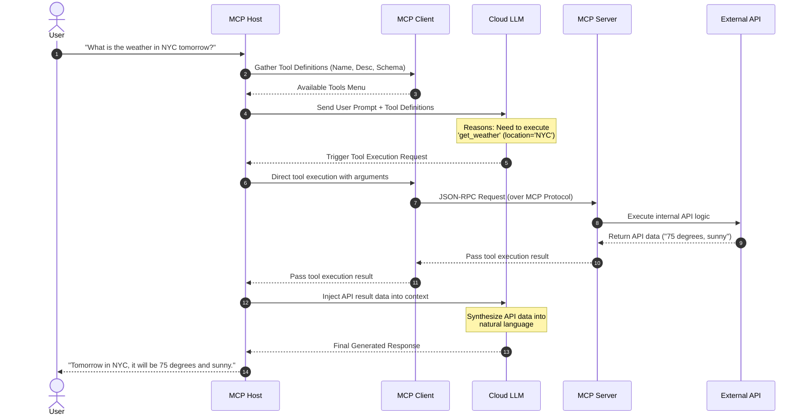

**Model Context Protocol (MCP): Interview Preparation Guide (Part 2)**

**1. Core Definition: The Anatomy of MCP Architecture**
At its core, MCP is an architectural bridge that gives isolated LLMs secure, standardized access to the outside world. While an LLM generates the text, the **MCP Host** (the application) and **MCP Client** (the routing mechanism) work together to expose a menu of capabilities to the model. When the LLM chooses to act, the Client communicates via the **MCP Protocol** to an **MCP Server**, which serves as a highly modular, single-purpose wrapper around a specific API, database, or local system process.

**2. Structured Notes & Key Concepts**

* **The MCP Host:** The overarching application (e.g., VS Code, Claude Desktop, Cursor, LangGraph) that contains the **MCP Client**.
* **Server Modularity:** An **MCP Server** should ideally have a 1:1 relationship with a specific system (e.g., a dedicated Slack Server, a dedicated Dropbox Server). However, a single server can contain multiple **Tools** (e.g., the Slack Server has `list_channels` and `send_message`).
* **Execution Environments:**
* **Host/Client:** Currently runs predominantly on the **Local Machine** (desktop apps), though this is shifting toward web services.
* **Server:** Can run **Locally** (the client spins up an instance directly on the machine) or **Remotely** (hosted on a VM or cloud service).


* **The Anatomy of a Tool:** To expose a function to an LLM, the MCP Server must define three critical parameters for every tool:
1. **Name:** The identifier for the function (e.g., `get_weather`).
2. **Description:** Plain-text explanation of what the tool does and what arguments it expects. *This is crucial because the LLM reads this description to decide if and when to trigger the tool.*
3. **Input Schema:** A structured dictionary defining the required data types (e.g., `location: string`).


**3. System Architecture & Process Flow**

Below is the execution flow of an MCP tool call, demonstrating how a user's prompt resolves into an external API action:



**4. Code Implementation: Implicit Tool Definitions**
Modern MCP SDKs allow you to avoid statically hardcoding the **Name**, **Description**, and **Input Schema**. Instead, they are implicitly derived from native Python structures:

```python
# The Host/Client will automatically parse this function to tell the LLM:
# Name = get_weather
# Description = "Fetches the current weather..." (from the docstring)
# Input Schema = requires 'location' as a string (from type hints)

@mcp.tool()
def get_weather(location: str) -> str:
    """Fetches the current weather for a specified city or location."""
    # Internal logic connecting to the Weather API
    response = requests.get(f"https://api.weather.com/v1/{location}")
    return response.json()

```

**5. AI Engineer Interview Q&A**

**Basic Concept Questions**

* **Q: What are the three required parameters to define a Tool in an MCP Server?**
* **A:** Every tool requires a **Name** (a unique identifier), a **Description** (human-readable instructions explaining when to use it), and an **Input Schema** (the exact arguments and data types the tool requires).


* **Q: Why is the "Description" field of an MCP Tool so critical?**
* **A:** The description isn't just for documentation; it acts as the primary system prompt for the LLM. The LLM reads the description to logically deduce whether a specific tool can solve the user's current request. A poorly written description leads to LLM hallucinations or failed tool calls.


**Advanced Architecture & Deployment Questions**

* **Q: How would you design the deployment architecture for an MCP Server compared to an MCP Client?**
* **A:** The **MCP Client** is always tightly coupled to the user's **Host Process** (like a desktop app or an agentic script). The **MCP Server**, however, is environment-agnostic. For operations requiring secure file access, I would deploy the server **Locally** using STDIO transport so data never leaves the machine. For integrating third-party SaaS APIs (like Slack or GitHub), I would deploy the server **Remotely** on a VM or container, allowing multiple clients to connect to it securely over SSE (Server-Sent Events) without distributing API keys to individual local machines.


* **Q: What is the architectural relationship between MCP Servers and Tools? Should you build one giant server for all tools?**
* **A:** No, the architecture strictly favors modularity. An MCP Server should ideally have a 1:1 relationship with a specific service or domain. For example, you build one MCP Server for Slack containing all Slack-related tools, and a separate MCP Server for Dropbox. This prevents namespace collisions, minimizes the token context window required to send tool definitions to the LLM, and allows developers to connect only the exact servers they need for a specific workflow.