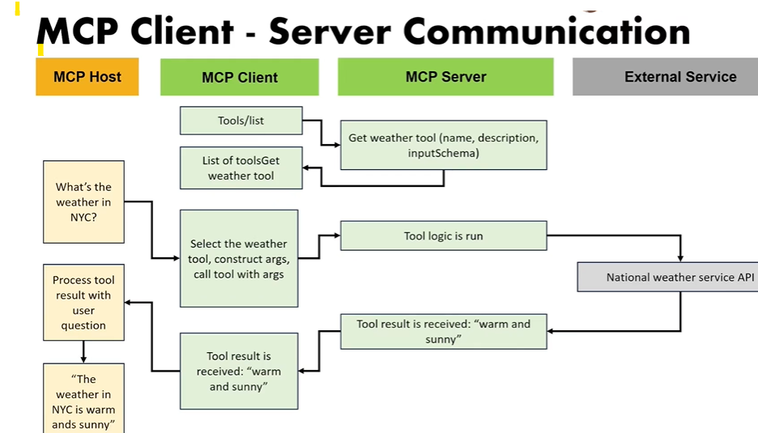
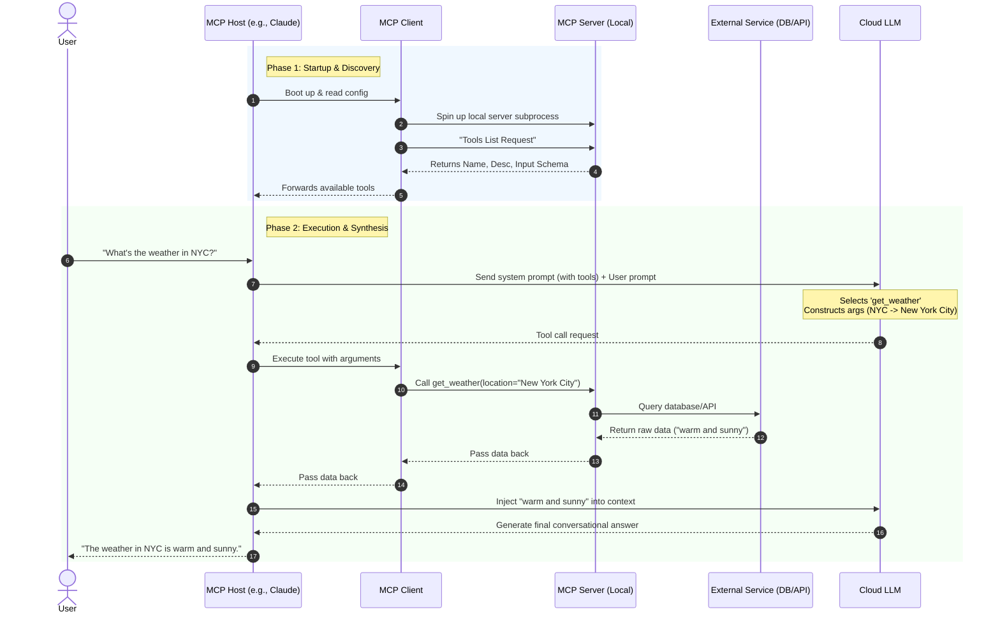

**Model Context Protocol (MCP): Interview Preparation Guide (Part 3)**

**1. Core Definition: The MCP Execution Lifecycle**
The MCP Client-Server communication protocol is a dynamic, automated handshake that turns a passive LLM into an active software agent. When an MCP application launches, the Client automatically polls connected Servers to discover their capabilities. The Host then injects this "tool menu" directly into the LLM's system prompt. When a user makes a request, the LLM acts as the routing engine—choosing the right tool and formatting the arguments—while the MCP Server handles the actual execution and data retrieval.

**2. Structured Notes & Key Concepts**
The complete lifecycle operates across four distinct verticals: the **MCP Host** (UI/Application), the **MCP Client** (Protocol Router), the **MCP Server** (Execution Environment), and the **External Service** (APIs/Databases).

* **Initialization & The Tools List Request:** Upon startup, the **MCP Client** reads its configuration, spins up the defined local server subprocesses, and immediately issues a **Tools List Request**. The servers reply with their tools' Names, Descriptions, and Input Schemas.
* **System Prompt Injection:** The **MCP Host** intercepts the tools list and dynamically rewrites the LLM's system prompt behind the scenes (e.g., *"You are an AI assistant. You have access to: get_weather..."*). This is how the model physically "knows" what it can do.
* **Argument Construction:** When the user asks a question, the LLM analyzes the prompt, selects a tool, and transforms user intent into structured arguments (e.g., translating "NYC" from the prompt into `location: "New York City"` for the schema).
* **Custom Logic Execution:** The **MCP Server** receives the structured arguments from the Client. This is where the developer's custom logic lives—the server queries the external database, logs the interaction, formats the payload, and returns the raw data (e.g., "warm and sunny") back up the chain.
* **Synthesis:** The LLM receives the raw data, pairs it with its memory of the original user question, and generates a synthesized, natural-language response.

**3. System Architecture & Process Flow**

**4. AI Engineer Interview Q&A**

**Basic Concept Questions**

* **Q: How does the MCP Client know what tools are available when an application boots up?**
* **A:** During the initialization phase, the MCP Client reads its server configuration, spins up the connected MCP Servers, and immediately issues a **Tools List Request**. The servers reply with an inventory of their tools, including names, descriptions, and input schemas.

* **Q: Where does the actual custom code or API interaction logic live in the MCP architecture?**
* **A:** All custom execution logic lives strictly within the **MCP Server**. The Host and Client merely route the structured requests. The Server is responsible for taking the LLM's arguments, interacting with the external database or API, and returning the result.

**Advanced Architecture & Development Questions**

* **Q: From a prompting architecture perspective, how is the LLM made aware of the MCP Server's capabilities?**
* **A:** The **MCP Host** dynamically injects the data from the Tools List Request directly into the LLM's system prompt. By appending instructions like *"You have access to the following tools..."*, the Host provides the LLM with the context required to output a structured tool-call request instead of a standard text response.

* **Q: Walk me through the exact state changes in the LLM during an MCP tool execution.**
* **A:** First, the LLM processes the user prompt against its system instructions and outputs a structured tool-calling stop reason rather than text. It halts generation. The host application executes the tool via the MCP Client/Server pathway. Once the raw data is returned, the host appends this data to the conversation context as a "tool observation" and prompts the LLM to resume generation. The LLM synthesizes the observation into the final natural language output.